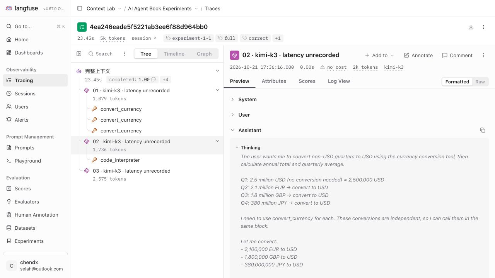

# Langfuse v4.67.0 upgrade

- Public UI/API: https://ai-tutor-helper.corp.youdao.com/langfuse
- Official release: https://github.com/langfuse/langfuse/releases/tag/v4.67.0
- Source commit: `21931f2c29ed7d02c106de290e00b67df9049e75`.
- Previous release: [v4.66.0](../2026-10-22/README.md).
- Custom image: `context-lab/langfuse-web:4.67.0-reasoning-subpath`.
- Image ID: `sha256:d7050e6a8ea33451ba8adc0e1b07f09e6b7132d3fa92922691db1e2be7d8c1c6`.
- Next build ID: `HyLpsrevIGJ6_pwKcnqAM`.
- Thinking patch: [reasoning-content.patch](../../patches/reasoning-content.patch),
  unchanged SHA-256 `e8a6e511e34aecb0571619c18857f359318b38f1b34dd2bd597a5d814acbb44f`.

The patch applies cleanly to v4.67.0. The upstream release does not change the
patched OpenAI normalizer, parser test or Next configuration. The one new
PostgreSQL migration adds nullable `installer_user_id` and
`installer_slack_user_id` columns to `slack_integrations` using `IF NOT EXISTS`.
There are no new ClickHouse migrations in this release.

The official GHCR amd64 web manifest matches Docker Hub:
`sha256:43e27dc6cf4fc852d90b3dc96784b2f479605cea8d106ddcd2064eb1a289e065`.
`image-receipt.json` records registry config digests and the rootless Docker
image IDs; containerd translates the legacy archive's image identity during
import, so the helper also verifies the exact layer diff IDs, platform and
runtime configuration. Only web/worker application images are upgraded.

The consistent pre-migration backup includes the five state directories,
private environment, Compose configuration, original source revision/patch and
web/worker image identities. It remains server-local under a mode-700 backup
directory; credentials and data archives are excluded from this repository.
The old source and v4.66.0 images are retained for runtime rollback.

`data-before.json` and `data-verification.json` compare the frozen historical
experiment with stored observations. No experiment is rerun or re-imported.
The canonical content checksum remains
`339b1951221e46b9330f405925ffe0a261f15f27b7eb4245de26bcf497d74a88`.

`patch-tests.json` records the two targeted test suites and lint checks. Full
repository lint and unrelated feature tests are omitted because the custom
patch is unchanged and this is a pinned upstream release upgrade. The complete
production build performs TypeScript checking and the client-bundle scan.

Build results: `Tasks: 5 successful, 5 total`, `Cached: 2 cached, 5 total`;
86 static pages; OTel worker smoke test passed; client-bundle scan
`scanned 378 files` and `clean`. Patch tests: shared `20 passed (20)`,
web parser `9 passed (9)`; targeted ESLint exited 0. Deployment helper tests:
Python `Ran 8 tests ... OK`, Node `tests 10 / pass 10 / fail 0`.

Runtime verification confirms web/worker v4.67.0, all four backing services
healthy and the nullable Slack migration applied. The public health API reports
4.67.0; Android downloads return 200 and retired routes remain 503. All five
experiments, 51 observations, 25 scores and 23,302 tokens match the pre-upgrade
baseline exactly. `runtime-verification.json` records the server-local backup
identity and restricted permissions.

Browser review retained the existing authenticated session and verified
Formatted Thinking expansion: two sections for full-context round 2, and only
one current section for the no-reasoning arm. See `browser-verification.json`.

